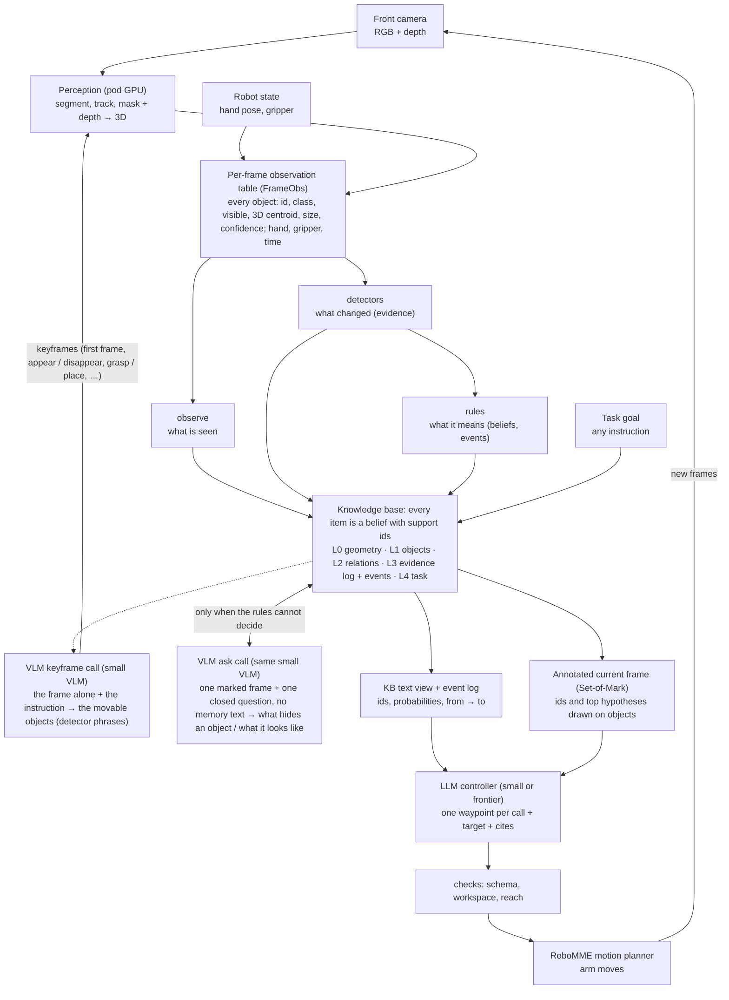

# ArbiterKB — Development Spec

Version 1.11 · 2026-10-29 · supersedes `INSTRUCTIONS.md` (kept for history). **v1.11 (user decisions after the 2026-10-28 tests, NOTES):** robot actions come only from robot state; **the periodic review call is removed** (a small VLM confirmed 68% of planted false events; neither qwen3.5-9b nor Sonnet 5.5 told a pick-up from a put-down in the front video, ≤ 0.52); the VLM's runtime job is **one closed question about one marked frame, with no memory text** (`ask.py`: what hides an object, what it looks like); relations come from geometry and rules, as in ECoMEM and Ledger; **L4 goal counter** (`goal_counter.py`: the goal parsed once per episode, the KB counts its own actions; counting 0.85 → 0.97 without thinking); **view v4** = v3 + the counter line + joined facts in words (`narrative.py`), no "now" sentences; **motion detector v2** (`motion.py`: hysteresis and a speed-valley split; G test F1 0.68 → 0.81); prompts and views are frozen with `prompts_hash` in `params.json`. **v1.10 (user decision, after a check):** the v1.9 merged keyframe prompt listed worse (2 / 4 and 0 / 4 real frames against 4 / 4; it copied objects from the memory text), so the **keyframe call lists from the image alone**, and the **review call takes over the annotator's work** (relations and descriptions, judged over a window of frames). **v1.9 (user decision):** two VLM calls, not three roles: the clue-object lister and the annotator become one **keyframe call** (one marked frame → objects, descriptions, relations), and the **review call** stays (every ~3 s + before acting). Roles are now rules, keyframe call, review call, controller. v1.1: after the M0 reviews, M1 is rewritten, phase G (the gate) is pulled forward, M2/M6 are adjusted. v1.2: after the M0.1 reviews, M1 shrinks to plumbing (no tuning before G), OverlapHaircut is added, and E5c is enforced through a test-read ledger. v1.3: after the M1 / M1.1 reviews: M2 (c) is against SoftHaircut, M4 adds an LLM-without-KB arm (C vs D tests the KB), G's gate uses rules with ≤ 2 features, R5 combines only same-frame covers; silent failure is always reported with coverage and AURC, M2 (c) compares at matched coverage and adds MarginHaircut, G records every pass (swapped or not) for an ROC, R5 skips mixed cubes. **v1.8 (user discussion):** four roles (rules, annotator, **reviewer**, controller). The reviewer replaces trigger-only checking: every ~3 s it reads the last few seconds of frames and the KB's events for that window, confirms / contradicts each, adds missing events and writes a one-line summary, plus one check before each action on a target. Semantic actions from robot state (actions.py) and the counting-test results are in §2.1. **v1.7:** §2.5 perception design (VLM clue objects, one multi-object Cutie, keyframes with matching and `id_margin`, async); §2.6 time budget; the M4 batch of view fixes. **v1.6:** M2 becomes conditional on G (only what G's result needs; claim 3 compares Bound, SoftHaircut and ArbiterKB); R7 deleted, R5 frozen; arms K0 and S added (§3.8). **v1.5:** §2 rewritten as the target loop with the reasoning behind it: observation table, observe / detectors / rules, VLM annotator (arbiter merged), annotated frame, controller; task-agnostic recording; open relation table; real-time notes. **v1.4 (direction v2, user decision; NOTES "Direction v2"):** the KB becomes the memory module of an **LLM controller that outputs the waypoints itself**, in the action format and harness of arXiv 2610.17350. Claims 1–2 (`docs/GOALS.md`): a smaller model, or far fewer tokens, at matched success. The old claim becomes claim 3. M3–M6 are rewritten (§3.8, §6); the rule planner stays as a baseline. G and M2 are unchanged.

This is the single source of truth for building ArbiterKB. Design rationale lives in the plan report ("ArbiterKB 项目规划报告") and in `scene-graph-robot/docs/` (`system-design-kb-2026-10-27.md`, `evidence-gaps-2026-10-28.md`). This file says **how**.

To build a phase, tell the coding agent: *"Build phase Mx of `arbiter-kb/DEVELOPMENT.md`. Read §0–§5 first, then §6.Mx. Stop when every check in Mx's 'Done when' list passes; then the user runs `/review-phase Mx` (§1.1)."*

---

## 0. Ground rules

1. **One phase at a time.** Each phase leaves the whole pipeline runnable end to end and adds one measurable change to the results table.
2. **Interfaces first, implementations later.** The contracts in §4 are fixed in M0. Changing one needs a `NOTES.md` entry ("contract change: what, why") and a bump of `arbiter_kb.CONTRACT_VERSION`.
3. **Never fake an output.** If something cannot run, print exactly what is missing (`SKIPPED: <reason>; to enable: <command>`) and continue.
4. **Don't modify `~/Code/active/scene-graph-robot/`. Copy, don't import.** The few functions ArbiterKB needs from `notebooks/pilot/sg_pilot.py` are copied verbatim into one file, `arbiter_kb/sg_compat.py`. Each copied function carries `# copied from sg_pilot.py:<line> @ e2e06f9`. The set is `Replay`, `load_replay`, `target_cube_nodes`, `ActiveTarget`, `decision_frame`, `cam_to_world`, `project_points`, `backproject_mask`, `oracle_graph`, `RuleParams`, `GraphTracker`, `wilson`, plus the `F_*` constants. This keeps arbiter-kb self-contained: its results cannot change because the other repo or branch changed. `tests/test_sg_compat.py` imports the original `sg_pilot` when it is present and asserts identical outputs on a synthetic input; otherwise it is skipped. Nothing else from scene-graph-robot is used.
5. **Compute.** M0–M4 run on the Mac CPU. GPU appears only in G, M5 and M6 (simulator rendering, perception and closed-loop control), and only after the user says go. The LLM is reached through OpenRouter from M4 onward.
6. **The user is learning.** Docstrings say *what, why and units*. Every phase adds a short walkthrough notebook (≤ 15 cells) that calls the package and shows intermediate results.

---

## 1. Engineering evals: the quality bar for every phase

Each eval is a concrete check that `make check` runs. A phase is not done until all pass.

| # | Eval | What it means here | Check (automated unless noted) |
|---|---|---|---|
| E1 | **Minimal** | The smallest code that does the job; no frameworks, no speculative abstraction | `scripts/quality.py`: every module ≤ 250 lines, every function ≤ 40 lines, ≤ 1 level of class inheritance, dependencies ⊆ the whitelist in §5.3. A new abstraction needs ≥ 2 call sites (reviewed in NOTES) |
| E2 | **Debuggable** | Any number in any table can be traced back to the observations that produced it | Every episode writes a trace (§3.9). `python -m arbiter_kb.debug explain --run R --ep E --cube C --t T` prints the support chain down to observation ids. A test asserts that the chain exists for every row of the results |
| E3 | **Correct by construction** | Invariants hold at every frame, not just at the end | `KB.check()` asserts the invariants (§3.2) after every `apply()` when `ARBITER_DEBUG=1` (the default in tests). Each rule has a unit test on hand-made frames |
| E4 | **Reproducible** | Same inputs → same bytes | Run twice → identical `summary.csv` hash (test). Every results file records the commit, args, `params.json` hash, contract version and LLM cache hit/miss counts |
| E5 | **Honest evaluation** | No future information, no test leakage, the same treatment for every system | (a) Causality test: a `PoisonedSource` raises if any frame after t is requested before step(t) returns. (b) Systems never see `GroundTruth`. (c) `evaluate.run` refuses test episodes unless the Params was loaded from a `params.json` whose stored hash matches, has `frozen: true`, and has a FREEZE entry in the append-only ledger `results/test_reads.log` (`arbiter_kb/ledger.py`); every test read appends a READ entry. (d) Baselines run through the same `MemorySystem` interface and the same evaluation code |
| E6 | **Explainable outputs** | Every decision says why | Every `PlanStep` carries `support` (evidence ids), every arbiter patch cites evidence ids, and every controller action names its target object and cites the KB items it used (from M4). Test: no inferred / arbiter item has empty support |
| E7 | **Fast feedback** | Iterate in seconds, not minutes | `pytest` < 60 s; the M0 synthetic evaluation < 60 s; median KB update < 1 ms per frame (printed by `--selftest`) |
| E8 | **Cost-bounded** | LLM spend cannot surprise you | Every call is cached on disk; the hard cap is `ARBITER_MAX_USD` (default 2.00) per run, after which the backend raises. Closed-loop arms (M5) need a higher cap: the user sets it per experiment after seeing the estimate. Calls, tokens, seconds and dollars are counted per episode |
| E9 | **Stable interfaces** | Later phases don't rewrite earlier ones | `tests/test_contracts.py` snapshots the field names of every contract dataclass. A change fails the test until `CONTRACT_VERSION` is bumped and NOTES updated |
| E10 | **Measured, not claimed** | Every claim in a README or NOTES points to a results file | Review item: each number in README/NOTES is followed by `(results/<file>)` |

### 1.1 Two independent reviewers: the phase gate

`make check` proves the code does what it says. It does not prove the code is right, or worth building. So every phase ends with two reviews by agents that did not build it. They are Claude Code subagents in `.claude/agents/`, with read-only tools, and each starts from a fresh context:

| Agent | Question | Anchor | Report | Blocking verdict |
|---|---|---|---|---|
| `code-reviewer` | Is the code correct, honest and minimal? | DEVELOPMENT.md §1–§3 | `reviews/<phase>_code.md` | BLOCK: wrong math, failing check, leakage or causality violation, faked or hard-coded result, non-reproducible |
| `goal-reviewer` | Does this phase move a claim, from first principles, without self-deception? | `docs/GOALS.md` | `reviews/<phase>_goal.md` | OFF-TRACK: moves no claim, headline result true by construction, test leakage |

**Procedure** (run in Claude Code inside `arbiter-kb/`):
0. One-time setup on the Mac (the agent files ship in `setup/claude/` because `.claude/` cannot be written remotely): `cd ~/Code/active/arbiter-kb && mkdir -p .claude && cp -R setup/claude/agents setup/claude/commands .claude/`
1. The builder finishes the phase: `make check` passes and NOTES is updated.
2. Run `/review-phase <phase>`. Both agents run in parallel. The builder must not pass them its own summary of the work.
3. The user reads both verdicts. Each BLOCK / OFF-TRACK finding is either fixed (then re-review) or explicitly overruled by the user, with the reason written in `NOTES.md`. MAJOR findings get a fix or a NOTES entry. MINOR findings are optional.
4. Tag `phase-<M>-done`. The next phase starts only after the tag.

The goal reviewer also answers "is the next phase still the best next step?". If it proposes a cheaper experiment that decides more, the user decides, and DEVELOPMENT.md §6 is updated before building.

Design patterns that make E1–E3 cheap (mandatory):
- **Rules are pure functions that return operations.** `rule(view, frame, params) -> list[Op]`. Only `KB.apply(ops)` mutates state, and `apply` logs every op to the trace. Rules are then trivially unit-testable, and the trace is complete.
- **One source of parameters.** All tunables live in one frozen dataclass per component, serialised together into `params.json`. No magic numbers in rule bodies.
- **Plain data over objects.** Contracts are dataclasses with numpy arrays and dicts; no hidden state outside `KB`.

---

## 2. Architecture (v1.5: the target system and why it is built this way)

The design follows Murphy's hybrid architecture as taught in the course: a knowledge base at the centre, a reactive fast loop, and deliberative plan / execute / monitor. Since v1.4 the KB is the **memory module of an LLM controller** that outputs the robot's waypoints itself (claims 1–2 in `docs/GOALS.md`). v1.5 (2026-10-28, user discussion) writes down the whole target loop.

### 2.1 The loop



Status (2026-10-28):

| Part | Built | Not yet |
|---|---|---|
| Perception | GroundingDINO → SAM → Cutie → centroid, offline on the pod (G, word list from the simulator scene: **privileged**); `--vocab open`: generic words + the task's phrases (written, not yet run); VLM object-listing benchmark (4 frames) | §2.5: VLM clue objects as the word list; one multi-object Cutie; no DINOv2; keyframes with matching; size / confidence in the table |
| Observation table (`FrameObs`) | id, class, visible, centroid, pixel, track_q, hand, gripper | size / box, visible fraction, detector confidence, last-clear-frame id, timestamp (contract change, `CONTRACT_VERSION` 2) |
| observe / detectors / rules | R1 R2 R3 R5 R6; appear, disappear, move from→to, near-pass, grip; hand pause; **semantic actions from robot state** (`actions.py`: pick up, release placed / set down / dropped, press, hold left / right; recall 0.97–1.0 against the dataset's subgoal labels, `results/latest/actions_vs_labels`); **motion v2** (`motion.py`, G test F1 0.68 → 0.81, `results/latest/motion_v2`) | near-pass detection under iid position noise (motion v2 fragments moves at 15 mm); press, reveal (R4); time-based thresholds |
| KB L0–L4 | centroid; objects; Inside (stored) + Near / On / LeftOf / Held (computed); evidence log + events; goal + counts; **L4 goal counter** (`goal_counter.py`; parse accuracy 99 / 100 / 86 on PickXtimes / BinFill / SwingXtimes, `results/latest/goal_parse_v3`) | open relation table (§2.3); size; relation accuracy against truth (pod) |
| VLM keyframe call (listing, v1.10) | `keyframe.py`: the frame alone + the instruction → clue objects → detector phrases; checks per entry; qwen3.5-9b 4 / 4 real frames (`results/latest/keyframe_check_v110`) | the re-benchmark on G's replays with truth (M4 item 8) |
| VLM ask call (v1.11) | `ask.py`: occluder and appearance questions, checked answers, evidence / descriptions in the KB; tested with a fake model. (The v1.8–v1.10 review call was measured and removed: `results/latest/review_video*`, `describe_*`.) | real calls with truth on G's replays (M4 item 10) |
| Views | **v4** (`views.controller_view`): v3 + the goal-counter line + joined facts in words (`narrative.py`); v3 on request; annotated frame (`som.py`) | |
| LLM controller | prompt, parsing (the last top-level JSON object), checks; arms H / K / K-L3 / R / K0 / S; Batch A (permanence, synthetic: K = R = 0.96 with thinking); **counting on RoboMME robot state: v3 view 0.83 / 0.94 (off / default) = Sonnet 5.5 with the raw log (0.94) at a fifth of the cost; v4 with the goal counter 0.97 / 0.96 on episodes 31–60** (`results/latest/count_robot_state_v3`, `count_robot_state_counter_v3`) | the full rerun on final sets; image arms (H, S); closed loop on the pod (M5) |

### 2.2 One step, in order

1. **Camera → perception (pod).**
   - GroundingDINO finds objects from words. SAM cuts out each object's mask. Cutie tracks the masks from frame to frame, so an object keeps its id.
   - Each mask's pixels are back-projected with the depth image, and their mean is the object's 3D centroid (`sg_compat.backproject_mask`). The mask is what makes the centroid right: a box would mix in table and background depth.
   - Perception is the only slow part (about 0.4 s per frame on an A40).
2. **The per-frame observation table (`FrameObs`)** is the hand-over between perception and memory. It holds one row per object, plus the hand pose, the gripper width and the frame number. It is the only thing the memory side reads; the memory never touches pixels.
   - The table exists for four reasons:
     - perception runs once and its tables are stored, so the memory can be replayed many times without a GPU;
     - any source can fill it: synthetic, simulator truth (the upper bound) or real perception;
     - corruptions are injected here, on the input side, never into the KB's answers (§3.11);
     - ground truth is not in it, so the memory cannot see the answer (E5b).
   - In a real-time system the table stays as an in-memory interface. It is also logged (a few hundred bytes per frame), so a failure can be replayed and explained offline.
   - What the table does not carry, the memory can never know. Widening it is planned (§2.1 status).
3. **observe** copies what is seen into L0 / L1: pose and "visible", each with its observation id `o<t>:<object>`. Objects not seen this frame are left alone.
4. **Detectors** compare this table with the previous one and write **evidence** (L3, ids `e1, e2, …`) only when something changed:
   - appear;
   - disappear, with the last position;
   - move start / stop, with where from and where to;
   - near-pass, with the closest 3D distance;
   - grip close / open, with the hand position.

   They read mostly perception's centroids. Robot state contributes only the gripper.
5. **Rules** read the new evidence and the current KB and return operations; only `KB.apply` changes the KB, and it logs every change. For example:
   - R1: a cube vanished next to a container → `Inside(cube)` gets a distribution, plus a `cover` event.
   - R6: two containers passed close → some mass moves between them.
   - R3: the gripper closed near an object → `grasp`; it opened → `place`, onto the object below.
   - R2: hidden or held objects move with their container or the hand.
   - R5: one cube per container, among the cubes covered in the same frame.
6. **VLM keyframe call (v1.10: listing only)** is a small VLM, thinking off, that sees only the current front frame and the instruction, and lists the movable objects on the table, up to 10, with `task_item` marks (§2.5). The list becomes the detector's phrases. It sees no memory text: in v1.9 the call also annotated, with the KB in its prompt, and it then listed objects from the text instead of the image (NOTES "Keyframe call check": 2 / 4 and 0 / 4 real frames, against 4 / 4 for the image-only prompt).
6b. **VLM ask call (v1.11, only when the rules cannot decide)** asks ONE closed question about ONE object in ONE marked frame (ids drawn; optionally a crop), with **no memory text** (`ask.py`):
   - **occluder:** an object has just disappeared; is it hidden by the robot arm, a container, or out of view? (Ledger's occlusion query.)
   - **appearance:** what the object looks like and its colour (the view's "looks like").
   - The answer is one of fixed options or "cannot tell", checked, and written as evidence or a description with `source: vlm`, supported by the frame. It never overwrites the rules.
   - **Why not a periodic review (v1.8–v1.10):** with the KB's text in the prompt a small VLM agreed with the text (it confirmed 68% of planted false events, against 58% of true ones), and from the front video neither qwen3.5-9b nor Sonnet 5.5 could tell a pick-up from a put-down (≤ 0.52). Robot actions come from robot state, identity from the tracker (Hungarian matching, `id_margin`), relations from geometry, and the window summary from the KB's own event log (code, not a VLM).
7. **Views** turn the KB into what the controller reads:
   - the **KB text + event log** (`views.controller_view`): goal and progress; objects with 3D centres and their observation ids; relations with probabilities and support; the event log in time order with ids, where-from and where-to. A hidden object's position is not printed as a coordinate: its Inside distribution is.
   - the **annotated current frame** (Set-of-Mark): the current image with each object's id and, for containers, the top hidden-cube hypotheses ("red? 55%") drawn on it. It ties the ids in the text to the objects in the picture, so the controller can aim at the right one and check the KB with its own eyes.
8. **LLM controller** reads the views plus the current front / wrist frames and the robot state. It outputs one waypoint (x, y, z, roll, pitch, yaw, gripper), the target object id and the KB ids it relied on.
   - The checks (schema, workspace, reach) run before the waypoint is sent. The distance from the waypoint to the cited target is logged, never enforced.
   - The motion planner moves the arm, new frames arrive, and the loop repeats.
   - The controller only reads the KB; it never writes it.

### 2.3 Design decisions and why

- **Record task-agnostically, retrieve task-specifically; mark what the task names.** Task items are parsed from the instruction text (`task_items.py`) and tagged in the KB and the view, never used to filter what is recorded. Perception's word list must not come from the simulator scene: G's run did that (privileged), and `perceive.py --vocab open` does not. Every detectable object and every change is recorded, whatever the current goal. The next task may ask about something the current one ignored, and memory not recorded cannot be recovered. The goal is used only when building views (what to show first).
  - Cheap things are kept for all objects every frame: id, position, visibility, events.
  - Expensive things are computed only when needed: descriptions and the occluder of a vanished object, by the ask call on one frame.
  - The opposite choice, keeping only what the current tasks need, is Clio's (arXiv 2404.13696). It can serve as a contrast arm.
  - Two parts are still task-bound today: perception's word list (an object outside it is never seen) and the evaluation, which scores only the target cube. Fix them by moving to class-agnostic segmentation, and by scoring every cube's Inside belief.
- **Four roles, each with one job; two of them are VLM calls (v1.9):**
  - **rules** (every frame, exact, cheap) decide what geometry and robot state can decide;
  - the **keyframe call** lists the objects from the image alone;
  - the **ask call** answers one closed question about one marked frame when the rules cannot decide (what hides an object, what it looks like);
  - the **controller** reads the KB and acts.

  Splitting the VLM work keeps each answer checkable against truth, and a mistake in one does not spoil the others. The split follows what the VLM must look at: listing must read the image alone (with memory text in the prompt it copied objects from the text, v1.9 check), while checking and annotating need the memory next to a window of frames (v1.10). Within each call, every item is checked against truth on its own (user discussion, 2026-10-28).
- **No periodic VLM review (v1.11):** measured and removed; see §2.2 step 6b.
- **Code every frame, language models only at moments that need them.** Geometry, time and change are cheap and exact in code (0.1 ms per frame). Meaning, appearance and unclear cases need a VLM, but calling it every frame would cost what the frontier baseline costs (claim 2).
- **Every item is a belief with support**, whoever wrote it (observe, a rule or the VLM). That makes the memory inspectable (`debug explain --item <id>` walks any id back to observations), lets it retract what turns out wrong, and lets it be measured for calibration against ground truth (claim 3).
- **Open relation table (L2).**
  - Today `relations` maps `(predicate, subject)` to a distribution over one object. That suits "exactly one of" relations such as Inside, but not many-to-many ones (Near).
  - The target is a table of `(predicate, subject, object) → belief {p, support, source: rule | vlm | arbiter, t}`. A new relation then needs a registered predicate and a rule or prompt that fills it, not a new data structure. The exclusive relations (Inside, Held) keep their distributions.
  - Relations most useful to a controller that outputs waypoints:
    - the offset from the hand to each object;
    - Reachable / Graspable / BlockedBy;
    - Inside / On / Under;
    - WasAt / OriginallyAt / StationarySince;
    - Pressed / Touching;
    - Target / Done / Before;
    - Ambiguous(a, b).
- **The observation table is the only door between pixels and memory.** That is why it must carry enough: size, confidence and a last-clear-frame id, not only centroids.
- **Real time.**
  - The table is an in-memory interface, logged for replay.
  - Perception, memory and controller run at their own rates: the KB updates whenever a table arrives, and the controller reads the latest KB.
  - Thresholds must be per second, not per frame, and the table must carry timestamps, because frames can be dropped.
- **What is not ours** (`docs/GOALS.md`):
  - open-vocabulary scene graphs with VLM captions and LLM edges (ConceptGraphs, arXiv 2309.16650);
  - local updates of a changing scene graph (DovSG, arXiv 2410.11989);
  - caption memory with time / place retrieval (ReMEmbR, arXiv 2409.13682);
  - an LLM emitting waypoints (arXiv 2610.17350).

  **Ours:**
  - short-horizon manipulation memory, in which hidden and swapped objects carry identity uncertainty as beliefs with support;
  - a time-ordered event log with where-from and where-to, as text the controller can cite;
  - calibration measured against ground truth;
  - the controlled comparison of memory content at a fixed controller and executor.

### 2.5 Perception design (v1.7)

The memory can only know what perception reports (§2.2 step 2). The target design follows the user's choice in the 2026-10-28 discussion:
- a small VLM names the scene's "clue objects";
- the existing GroundingDINO → SAM → Cutie pipeline tracks them;
- keyframes, not every frame, pay for the expensive steps.

1. **Clue objects from a VLM, not from the simulator.**
   - At the first frame and at keyframes, the keyframe call (a small VLM with **thinking off**, §2.2 step 6) reads the current front frame and the instruction. It lists every movable object on the table (not the table, not the robot), up to 10, as `{name, color, count, task_item}`.
   - The list becomes the detector's phrases: one tracker slot per object, and identical objects get one slot per count.
   - Objects the instruction names are marked `task_item` (`task_items.py`). They are tagged, never used as a filter.
   - The prompt asks for all movable objects, not only the task's, so the memory stays task-agnostic (§2.3).
   - G's run took the object list from the simulator scene (`--vocab scene`, **privileged**). `--vocab open` (generic words + task phrases) is the fallback when no VLM is available.
2. **Model choice** (`results/latest/vlm_list_bench/`, NOTES; 4 real frames only, so re-test on G's replays before freezing):
   - qwen/qwen3-vl-8b-instruct and qwen/qwen3.5-9b (thinking off) listed all 4 frames right, in about 1 s and for under $0.0003 per frame;
   - models under 8B invented or misnamed objects;
   - every model called the white containers "white cubes". The name only has to work as a detector phrase.
3. **Tracking.**
   - **Today:** one Cutie processor per slot (sg_pilot). Each slot encodes the image every frame, which is about 0.4 s per frame with 7 slots on an A40.
   - **Target:**
     - one Cutie processor tracking all objects (one image encoding per frame);
     - no DINOv2 (computed per frame today and never read);
     - SAM encodes a keyframe once and then segments each box;
     - slots that have not found their object retry GroundingDINO every few frames, not every frame.
4. **Keyframes.**
   - **Triggers:**
     - the first frame, and the first frame after the scene settles;
     - an object appears or disappears;
     - a grasp or place;
     - a close pass **after the two objects separate**;
     - a drop in track quality (mask area jump);
     - a periodic check every 2–3 s;
     - just before the controller acts on a target.
   - **Work:**
     1. the keyframe call (one VLM call, the image alone): new objects (new slots);
     2. GroundingDINO + SAM on the phrases;
     3. match the new masks to the existing tracks (Hungarian on mask IoU + 3D distance): matched → re-seed Cutie; new → new slot + `appear` evidence; unmatched old → not visible;
     4. a new object's description comes from one ask call (appearance) on this keyframe, now that its id is drawn;
     5. record the last clear frame per object.
   - **Never re-match during a close pass.** When the matching is ambiguous (the best and second-best costs are close), write `id_margin` evidence instead of silently picking one. That margin is the signal R6 and Inside need, so the Hungarian step returns here, as part of perception.
   - **Keyframes run asynchronously.** Tracking and the controller do not wait for them, except for the check before an action on a target.
5. **Background** (needed only if class-agnostic SAM segmentation is ever used): drop the table and floor plane (depth RANSAC), the robot (its known joint state; in simulation, its segmentation id), and tiny, huge or unstable masks. Cap the tracks at 12–16, with task items first. The cap is chosen by measured recall on G's replays.

### 2.6 Time budget (v1.7)

All numbers are per closed-loop episode. A footnote gives the source of each estimate.

| Part | Before (G's perception, dry-run controller) | v1.7, unoptimised | v1.7, optimised | arXiv 2610.17350 |
|---|---|---|---|---|
| Object list | simulator (privileged) | VLM, thinking off | same | the model reads images |
| Start-up (load models, once per process) | about 35 s ¹ | about 35 s | about 35 s | — |
| Episode start | first detections | + VLM list, about 1 s ² | same | — |
| Tracking per frame | 0.4 s ¹ (7 slots, 7 image encodings + DINOv2) | 0.5–0.6 s ³ (6–10 slots) | well under 0.4 s ³ (one Cutie, no DINOv2) | — |
| Frames tracked | every frame | every frame | every 3rd control step (the paper's 0.15 s) | every 3rd step |
| Keyframes | none (detection only at first sight) | VLM about 1 s ² + re-detection 2–5 s ³ | same, asynchronous | — |
| Ask calls (only when the rules cannot decide) | — | about 1–2 s per call, a few per episode (estimate) | same | — |
| Controller call | about 40 s ⁴ (default thinking, about 2,100 tokens) | about 40 s | about 1–3 s ³, if lower thinking keeps accuracy (to be measured) | 18.3 s ⁵ |
| Controller calls per episode | — | about 10 ⁵ | about 10 | 9.5 ⁵ |
| Images per controller call | 0 (text dry run) | 2 + KB text (about 1,500 tokens) | same | median 148 in the final request ⁵ |
| Model time per episode | — | about 400 s | about 10–30 s | about 174 s ⁵ (9.5 × 18.3, our derivation) |
| LLM cost per episode | — | a few cents | less | about $0.39 ⁵ |

¹ G smoke test, measured. ² VLM benchmark, measured. ³ Estimate, to be measured on the pod or the Mac. ⁴ Text dry run: about 2,100 reasoning tokens per call at about 50 tokens/s. ⁵ The paper.

**What decides the total:**
- the controller's thinking: measure off / low / default against accuracy, in the dry run;
- the number of frames tracked: track every 3rd step, with **per-second** detector thresholds and timestamps (§2.3).

Start-up and keyframes do not matter as long as keyframes stay asynchronous (user, 2026-10-28).

### 2.7 Code map

| Concept | Code |
|---|---|
| Observation table and contracts | `types.py` (`FrameObs`, `ObjObs`) |
| Sources (synthetic, oracle replay, corrupted, perceived) | `sources/*` (only sources know where observations come from) |
| observe | `observe.py` |
| Detectors (Hungarian identity check in M2) | `detectors.py`, `identity.py` (M2) |
| Rules R1–R8 | `rules.py` |
| KB L0–L4, beliefs, support, retract | `kb.py`, `beliefs.py`, `ops.py` |
| Views: facts / ask, KB text, event log, controller view, annotated frame | `views.py`, `som.py` |
| VLM keyframe call (listing) | `keyframe.py` (`list_objects`), `llm.py`, VLM client `llm.vlm_client` |
| VLM ask call (one closed question) | `ask.py` (`ask`); its lines in the event log: `views._vlm_line` |
| L4 goal counter; the view in words | `goal_counter.py`; `narrative.py` (joined facts, the worded test views) |
| Container motion | `motion.py` (v2) |
| Semantic actions from robot state | `actions.py`; RoboMME dataset source `sources/lerobot.py`; forward kinematics `fk.py` |
| LLM controller | `controller.py`, `llm.py`; the closed-loop harness `stress/` or `harness.py` (M5) |
| Rule planner + skills (baseline) | `planner.py`, `skills.py`, `reach.py` |
| Baselines | `systems/baselines.py`, `systems/soft_haircut.py` |
| Evaluation, metrics, comparisons | `evaluate.py`, `metrics.py`, `compare.py` |
| Debugging | `trace.py`, `debug.py` (`explain`, `explain --item`) |

---

## 3. How the framework works

### 3.1 One episode

```
system.reset(meta)
for frame in source.frames(ep):          # strictly one frame at a time (E5a)
    system.step(frame)                   # fast loop; may call the arbiter on a trigger
    if frame.t == gt.t_star (evaluation only; the system is not told):
        record system.believe_inside(target), system.plan(target)
```

Inside `ArbiterKBSystem.step(frame)`, the order is fixed:
1. `ops = observe(view, frame)`: L0 poses and L1 visibility from the observations (§3.4).
2. `ops += detect(view, frame)`: new evidence (appear / disappear / move_start / move_stop / near_pass / gripper / track_drop). From M2: `+ identity(view, frame)` → `id_margin` evidence.
3. `ops += rules(view, new_evidence, frame)`: R1–R8 (§3.5).
4. `kb.apply(ops)` → trace.
5. `ops = monitor(view)` → risk evidence and downgrades (M3) → `kb.apply`.
6. If `trigger(view, new_evidence)` and the budget allows: `patch = arbiter.review(kb.text_view(), new_evidence, keyframes)` → `validate` → `patch_to_ops` → `kb.apply` (M4).

`view` is a read-only snapshot accessor on the KB, so rules cannot mutate.

### 3.2 KB data model

- `objects: dict[id, ObjectFrame]` (L0 + L1). The pose is a `Belief` whose value is an xyz array; visibility is a `Belief` over {visible, hidden, held, occluded_by_arm, out_of_view, unknown}.
- `relations: dict[(pred, subject), Distribution]` (L2), e.g. `("Inside", "cube_green") → {bin_1: .55, bin_2: .45, None: 0}`.
- `evidence: list[Evidence]` (append-only, ids `e1, e2, …`); `events: list[Event]` (L3, append-only, always cite evidence).
- `task: dict` (L4): goal, plan pointer, progress. Counts are derived by `count()` and never stored.
- `support` is a list of ids on every Belief, Distribution hypothesis and Event. `retract` scans all items (cheap at this size; a reverse index can come later if profiling asks for it).

Invariants (`KB.check()`): (I1) every Distribution sums to 1 ± 1e-9; (I2) no position inside any key; (I3) counts only via `count()`; (I4) every `inferred` / `arbiter` item has non-empty support, and all support ids exist; (I5) no arbiter-sourced numeric pose anywhere; (I6) at most one live `Inside` distribution per cube.

`retract(id)` (as implemented in M0.2): every item whose support contains `id` (transitively, through events) is downgraded, and every step is logged.
- A Belief gets `conf ← conf · 0.5` with the id removed from its support. Its source stays `inferred` while support remains, otherwise it becomes `prior` (keeps I4).
- A Distribution hypothesis backed by `id` loses its **current** mass, and the rest is renormalised; if nothing is left → `{None: 1}`. After a `swap_mix`, each hypothesis keeps its own evidence (a key that receives mass for the first time inherits the partner's), so this is an approximation. Exact per-origin mass tracking is due in M3, where R4 first retracts.
- Retracting an id that backs only the whole distribution (e.g. a near-pass) moves half of the mass to `None`; it does **not** undo the mix. To undo a mix (M4's `unlikely`), restore the pre-mix distribution from the trace.

Views: `ask(pattern)` (course `unify` / `satisfy`; returns `[(bindings, prob)]`); `text_view()` (one line per object, ≤ 40 tokens each); `som_image(frame_rgb)` (Set-of-Mark: ids + top-2 hypotheses drawn on the image; needs RGB, so replays only).

### 3.3 Belief math

`Distribution` over containers ∪ {None}. Operations (all renormalise):
- `from_distances(d: dict[id, float], sigma)`: p ∝ exp(−(d² − min d²)/2σ²). The shift prevents underflow; with no candidate → `{None: 1}`, citing the evidence that triggered it.
- `swap_mix(a, b, w)`: p'(a) = (1−w)·p(a) + w·p(b), p'(b) = (1−w)·p(b) + w·p(a). This means "with probability w the tracks a and b exchanged identity". It asserts 0 ≤ w ≤ 1.
- `flatten(f, plausible)`: p ← f·p + (1−f)·uniform(plausible); used by R8 with f = 1 − w_risk (R7's decay use was removed in v1.6). An empty `plausible` is a no-op.
- `joint_exclusive(dists)`: R5. Over injective assignments π of hidden cubes → containers (N ≤ 3, enumerate ≤ 24), P(π) ∝ Π_h p_h(π(h)); return the marginals.
- `max_prob`, `argmax`, `entropy`.

Pose beliefs: `conf ← conf · λ_pose^Δt` while unconfirmed.

### 3.4 Observation → L0/L1

- Visible object: `pose = Belief(xyz, conf=track_q, t, "observed", [obs_id])`, `t_last_seen = t`.
- Visibility state machine (deferred until after G; VideoUnmaskSwap metrics read only visible / hidden / unknown): visible → `hidden` if a container is within `r_cover` of the last xy at the disappear frame; → `held` if the gripper is closed (width < `g_closed`) and the EE is within `d_grip`; → `occluded_by_arm` if the EE is within `d_occ` (no container) and the object reappears within `T_occ` frames; → `out_of_view` if the last uv is within `m_edge` px of the border; else `unknown`.
- Hidden cube display pose (R2): Σ_c p(c)·pose(c). Decisions use the distribution, never this pose.

### 3.5 Rules (exact form; parameters in `RuleParams`)

| Rule | Fires when | Ops | Phase |
|---|---|---|---|
| R1 cover | cube visible→not visible at t, and containers visible at t with xy distance d < `r_cover` to the cube's last xy | `SetDist(Inside(cube), from_scores(d, σ_cover))`; no container within `r_cover` → `{nearest visible container: 0.5, None: eps_far = 0.5}` (the cover was not seen; the container is listed first, so it stays the answer; M2 infra); no visible container → `{None: 1}`; `AddEvent(cover)`. Covers the teleport case: the container appears in the same frame | M0 |
| R2 follow | each frame for hidden cubes | update display pose | M0 |
| R3 held | gripper closed near x | `Held(x)`; pose follows the EE | after G (no current metric needs it) |
| R4 reveal | container z > 0.15 and cube x observed at the container's former xy | `SetDist(Inside(x), {c: 1})`, `source="verified"`, plus `Retract` of contradicted hypotheses | M3 (needs a reveal: a container lifted) |
| R5 exclusive | two or more cubes covered in the same frame | `SetDist` = marginals of `joint_exclusive` over the cubes covered **in this frame** only (their R1 beliefs are independent, so the joint is exact). Earlier cubes are left out: their beliefs may already be R5/R6 outputs, and recombining them counts the constraint twice (M1.1 review). Covers on different frames are not linked; an exact joint table over all hidden cubes is the upgrade if a source needs it. No consistent assignment → `AddEvidence(exclusive_conflict)` for M3's R8 | M1; **frozen in v1.6** (never fired on stock layouts: kept, not extended) |
| R6 swap | a `near_pass(a, b)` evidence closes (M0), or `id_margin < m_thr` (M2) | `MixDist(Inside(h), a, b, w)` for every **hidden** h with mass on a or b; `AddEvent(swap)` only when w > 0. M0: w = w_mix·(1 − closeness). M1: w = w_max·exp(−d/d0), with d the 3D closest-approach distance (the M0 image form was removed in M1.1: the detector always records d). M2: w from the identity margin and G's measured signature | M0 / M1 / M2 |
| ~~R7 decay~~ | — | — | removed in v1.6 (never switched on); `flatten` stays for R8 |
| R8 consistency | two objects within `d_same`; a "hidden" cube observed; an expected container missing | `AddEvidence(risk)` + `MixDist` toward uniform with `w_risk` | M3 |

### 3.6 Monitor and decision

`decide(dist) → act | act_on_argmax | verify`, with thresholds `τ_hi`, `τ_lo` (M3 tunes them on train). They maximise expected utility U = +1 (act, correct), −`c_wrong` (act, wrong), −`c_verify` (verify), with defaults c_wrong = 1, c_verify = 0.3. On stock RoboMME, "verify" cannot execute (a wrong lift is an immediate failure), so it is scored as an outcome only.

### 3.7 VLM keyframe call, VLM ask call, and the arbiter protocol

**v1.5:** the arbiter is merged into the VLM annotator. **v1.9:** the annotator and the lister were one keyframe call. **v1.10:** the keyframe call only lists, from the image alone; the annotator's work (relations, descriptions) moves to the review call. **v1.11:** the review call is removed; the ask call answers one closed question per marked frame.

**VLM keyframe call (`keyframe.py`).**
- **When:** at every keyframe (§2.5 item 4).
- **Input:** the current front frame and the instruction; no memory text.
- **Output (strict JSON):** `{"objects": [{"name": "cube", "color": "red", "count": 1, "task_item": true}]}`.
- **Checks:** per entry (names of 1–2 words, one-word colour, counts, cap of 10); task items also from the instruction text.

**VLM ask call (v1.11; `ask.py`).**
- **When:** only when the rules cannot decide: a cube disappears with no container close enough (occluder), or a new object gets its id (appearance). Budget per episode in M5.
- **Input:** one front frame with the ids drawn (`som.py`), optionally a crop around the object, and one question naming the object's id. **No KB text, no goal.**
- **Output (strict JSON):** occluder `{"answer": "robot_arm|container|out_of_view|cannot_tell"}`; appearance `{"description": "<= 12 words or cannot_tell", "color": "<one word or cannot_tell>"}`.
- **Checks:** a fixed option; a description of at most 12 words with no numbers.
- **Written as:** occluder → evidence `vlm_occluder` (shown in the event log); appearance → the `description` fact (shown as "looks like"); support = the frame.
- **Measured** (M4 item 10): on G's replays against simulator truth, per question type: accuracy, the "cannot tell" rate, and a text-only control (the question without the image) for guessing.
- **History (v1.8–v1.10):** the periodic review call (checks, missing events, relations, identity, summary over a window) was measured on 60 RoboMME video windows and removed (NOTES "Review call on real video", "What can a small VLM see in a window").

The arbiter protocol below (v1.3) is kept as a reference; identity is now the tracker's job (Hungarian matching, `id_margin`).


- **Triggers:** a `near_pass` closes; a cube disappears with ≥ 2 candidate containers; `track_drop`; a risk evidence; and every `K` frames while something is hidden. Budget: ≤ 6 calls per episode, at least 20 frames apart.
- **Input** (≤ 1,500 tokens): the system prompt (role: reconcile hypotheses; JSON only; cite evidence ids; never output coordinates or probabilities), `kb.text_view()`, the evidence lines since the last call, and ≤ 2 Set-of-Mark keyframes (max-overlap frame and min-margin frame; replays only).
- **Output (JSON schema, strict):**
  ```json
  {"events":[{"type":"swap|cover|none","args":["bin_1","bin_2"],"strength":"clear|ambiguous|unlikely","cites":["e19","e20"]}],
   "hypotheses":[{"cube":"cube_green","keep":["bin_1","bin_2"],"cites":["e12","e20"]}],
   "risks":[{"obj":"bin_2","reason":"<=80 chars","cites":["e21"]}]}
  ```
- **Validator:** schema; every id exists; every `cites` non-empty and existing; `keep` ⊆ containers that currently hold mass or are cited; no numeric field at all (strength is categorical). On failure: one retry with the error text, then fall back to RuleOnly for this trigger (logged).
- **Patch → ops:** swap `clear` → `MixDist(w = 1 − ε)` (a full exchange); `ambiguous` → `w = 0.5`; `unlikely` → `w = 0`, which undoes the rule's mix by restoring the pre-mix distribution from the trace (not via Retract, which only moves mass to None; §3.2). `keep` drops the mass of the other containers (renormalised). Each risk becomes `AddEvidence(risk)`. Numbers come from this fixed table (method a) or, as an ablation, from self-consistency over k = 5 samples (method b: the agreement rate becomes w).
- **What the arbiter can never do:** write a pose, create an object, or edit evidence.

### 3.8 Controller (v1.4) and the rule-planner baseline

**LLM controller** (M4–M5). It follows the 2610.17350 harness, whose code is released (github.com/jackbjed/embodied-astra-robomme), so that the only difference between arms is the memory the controller reads.
- **Loop.** One call per action. After each executed waypoint, the controller receives the feedback the paper gives: TCP pose, finger positions, elapsed control steps, camera intrinsics / extrinsics, plus the new frames. The episode ends at the RoboMME step limit (1300) or when the model declares completion. Failures are counted with the paper's rules: simulator errors, unusable answers, three consecutive actions that execute no steps. No episode is excluded or retried.
- **Action (strict JSON):** `{"waypoint": [x, y, z, roll, pitch, yaw], "gripper": -1|0|1, "target": "<object id or null>", "cites": ["<KB ids>"], "done": false, "note": "<= 80 chars"}`. Units are metres and radians, in the world frame. `target` and `cites` exist for explanation (E6). They do not constrain the waypoint.
- **Validator:** schema; finite numbers inside the workspace box; `target` and every `cites` id exist in the KB; the reach check (`reach.py`) on the waypoint. An unreachable waypoint is returned to the model once with the reason, as the paper's executor would fail it. A second failure counts as an unusable answer. **Logged, not enforced:** the distance from the waypoint to the cited target's KB centroid, an analysis column that never blocks.
- **Memory arms** (same model, prompt skeleton, action format, limits):

| arm | the controller reads | tests |
|---|---|---|
| H | the full image history, as in 2610.17350 (front every 0.15 s, wrist, task video) | the paper's memory, with our model |
| R | the raw tracker log as text (per-frame positions and visibility) + current frame(s) | perception without structure |
| K | the KB text view (L0–L4) + the event log + current frame(s) | **the KB** (claims 1–2) |
| K−L3 | K without the event log | does the event history matter |
| K+A | K with the arbiter correcting beliefs at triggers (§3.7) | does belief arbitration help the controller |
| K0 | the current frame's object table (3D centres now) + current frame(s); no relations, events or history | is K's gain memory, or just being given coordinates? (M3a goal review) |
| S | the current frame(s) + one sentence per hidden object: "cube_red is under bin_0" (the KB's argmax, Bound-like) | if S ties K, the KB's structure adds nothing on that task |
| ref | 2610.17350's GPT-6-Astra row (92.1%, $0.39 per episode), copied from the paper | reference from a different run, labelled |

  Order of the falsification tests: K vs **S** and K vs **K0** first (cheapest, and the strongest falsifiers: does the structure matter, and is it more than coordinates?), then K vs R and K vs H. Fix the success margin that counts as "matches" and the number of episodes before any run (50 test episodes give about ±6 pp). Claim 1: K with the small model vs ref, and vs H with the small model. Claim 2: K vs H with the same model, on success and on tokens / images / $ per episode. K with an **oracle** KB (filled from simulator state) is reported as an upper bound only. The claims use a KB filled from perception.
- **KB text view for the controller** (`views.py`):
  - one line per object: id, class, colour, 3D centroid, extent, visibility, last seen;
  - L2 relations with probabilities, e.g. `Inside(cube_red): bin_0 0.55 | bin_2 0.45`;
  - the L3 event log in time order, with where-from and where-to ("t=60 bin_0 moved (0.14, 0.02) → (−0.03, 0.13); passed bin_2 at 1.2 cm: possible id swap");
  - L4 goal and progress.

  Budget: ≤ 1,500 tokens. Every line carries its KB id, so `cites` can point to it.

**Rule planner (baseline; M0–M2 offline evaluation).**
- `plan(view, cube) → PlanStep(skill, target, conf, decision, support, waypoints)`. The target is the argmax of `Inside(cube)`; `decision` comes from §3.6.
- `pick(c)`: four 7-D waypoints `[x, y, z, roll, pitch, yaw, gripper]` in the world frame: pre-grasp (xy_c, z = 0.20, open), descend (xy_c, z_c, keep), close (−1), lift (z = 0.20, keep). Orientation is top-down (π, 0, yaw_c); yaw is 0 until container yaw is estimated.
- **Reach check** (used by both): a numpy damped-least-squares IK on Panda DH parameters, from the base at (−0.615, 0, 0). mplib has no macOS arm64 wheel, so the authoritative mplib check runs only on the pod.

### 3.9 Trace and debugging

- `results/runs/<run_id>/traces/<system>_<source>_<ep>.jsonl`, one line per frame: `{t, obs: {id: [visible, xyz, track_q]}, evidence: [...], ops: [{op, target, before, after, rule}], arbiter: {...} | null}`. Tests use gzip off; full runs gzip on.
- `debug explain`: walks support ids back to observations and prints a tree.
- `debug timeline`: plots one cube's distribution over time with evidence markers.
- `debug diff --a SYS1 --b SYS2` and `KB.restore()`: not built yet; add them when a debugging session needs them (YAGNI). `KB.snapshot()` exists.
- CLI: `python -m arbiter_kb.debug explain|timeline --run RUN_DIR --condition C --system S --ep N --cube ID [--t T]`. Trace files are `RUN_DIR/traces/<condition>_<system>_<ep>.jsonl`.

### 3.10 Evaluation definitions

- **Ground truth:** `cube_to_bin` (fixed at cover time; the cube rides with its container); `t_star` = synthetic: last frame; replays: `decision_frame(rep)`; the target from `task_goal` (`target_cube_nodes`). Multi-target episodes: evaluate each target at the frame it becomes active (`ActiveTarget`).
- **Correctness is physical:** the system's label whose believed position is nearest the true container at t* (≤ 5 cm). Under id corruption labels lie, so the id alone cannot be trusted (NOTES M0 deviation 2).
- **Per row:** `pred, p_max, correct, decision, entropy, grasp_err_m, moved, corrupted`.
- **Metrics:** accuracy; **silent-failure rate** = P(wrong ∧ p_max ≥ τ_hi), always reported with **coverage** = P(p_max ≥ τ_hi) (a system can reach 0 silent failures by lowering all confidences, so the two are only meaningful together) and **AURC** (area under the risk–coverage curve: rows answered from most to least confident; risk = error rate among rows at least that confident; ties enter together; threshold-free, lower is better), with a risk–coverage figure; detection rate = P(p_max < τ_hi ∨ risk | wrong); Brier = mean Σ_c (p_c − 1[c = true])²; ECE (10 equal-width bins on p_max); reliability diagram; decision outcomes; cost per episode (calls, tokens, s, $); grasp error. 95% Wilson intervals for rates. Split moved vs back-at-start.
- **Splits:** synthetic train seeds 0–999, test seeds 1000–1999; RoboMME train episodes for tuning, the 50 test episodes only after the freeze. A split is read from `EpisodeMeta.split`. Every test read is checked against, and appended to, `results/test_reads.log` (E5c). **Any new or changed parameter** (e.g. M1's w_max, d0, c, j_max) means re-freezing `params.json` (a new FREEZE line) before the next test read.

### 3.11 Corruption model (input side, never output side)

A corruption must look like a real tracker error, otherwise results are true by construction (docs/GOALS.md, Known traps).
- `id_swap` (M0, **teleport, sanity only**): at the closest approach of the target container's first swap, exchange the two ids for all later frames. The label jumps about 12 cm in one frame (0.116–0.138 m on train seeds, `results/m0_synthetic_stats.json`), which no real tracker does. Never used for tuning or claims.
- `id_swap_overlap` (M1): swaps happen only where the two containers' 3D centres come within `d_ov` (default 0.03 m) of each other, i.e. where the tracks really overlap. The synthetic generator needs `lane_offset` ≤ about 0.03 for this. The ids are exchanged at a frame inside the overlap, so the label jump is ≤ `d_ov`. p_swap is the probability that an overlapping pass swaps (episodes chosen by seeded hash, nested). The measured jump distribution is reported with every result.
- `id_swap_measured` (M2, after G): swap rate and signature (overlap, `track_q` drop, jump size, phase of the swap) taken from phase G's measurements of the real tracker, not chosen by us. Built after G (NOTES "G — gate result"): `MeasuredSwapSource` reads `results/g_signature.json` (written by `scripts/measure_swaps.py`): p(swap) = logistic(min_3d, speed) with min_3d clamped to G's range, an exchange at t_min + G's offset after one track drops out for G's dropout length, and G's dropout lengths on clean passes.
- `pos_noise` (M1): Gaussian xyz noise σ ∈ {5, 15} mm on visible objects.
- The old Q1/Q2 (`sg_pilot.corrupt`) overwrite the bound rule's output. They stay available only to reproduce old numbers for the baselines.

---

## 4. Code layout and contracts

```
arbiter-kb/
  .claude/agents/{code-reviewer,goal-reviewer}.md  .claude/commands/review-phase.md
  docs/GOALS.md   reviews/
  DEVELOPMENT.md  README.md  NOTES.md  Makefile  requirements.txt  .env (git-ignored)  .gitignore
  arbiter_kb/
    __init__.py          CONTRACT_VERSION = 1
    types.py             ObjObs, FrameObs, EpisodeMeta, GroundTruth, PlanStep
    beliefs.py           Belief, Distribution (§3.3)
    kb.py                ObjectFrame, Evidence, Event, Op types, KB (apply/check/ask/retract/count/views/snapshot)
    sg_compat.py         functions copied from sg_pilot.py (§0.4)
    ledger.py            append-only test-read ledger results/test_reads.log (E5c)
    params.py            RuleParams, DetectParams, MonitorParams, ArbiterParams, load/save/hash/freeze
    trace.py  debug.py
    sources/  __init__.py synthetic.py replay.py corrupt.py perceived.py(M6)
    systems/  __init__.py baselines.py arbiter_kb.py
    observe.py  detectors.py  identity.py(M2)  rules.py  monitor.py(M3)
    arbiter.py(optional)  llm.py(M4)  controller.py(M4)  harness.py(M4)  planner.py  skills.py  reach.py(M4)
    evaluate.py  metrics.py  plots.py
  scripts/  run.py  selftest.py  quality.py  make_notebook.py  measure_synthetic.py  copy_replays.sh(G)  measure_swaps.py(G)  tune.py(M2)
  stress/   stress_env.py  render.py  perceive.py  POD_RUN.md   (G; runs on the pod, outside the package)
  results/  test_reads.log (ledger)  latest/<run>/{summary.csv, meta.json} (committed, --keep only)  runs/ (git-ignored)
  tests/    one file per module + test_contracts.py test_causality.py test_repro.py
  notebooks/ m0_walkthrough.ipynb … (one per phase)   executed/
  results/  runs/<run_id>/{rows.csv, summary.csv, params.json, meta.json, traces/}  llm_cache/
  figures/
```

Contracts (`types.py`; fixed in M0):

```python
@dataclass
class ObjObs:  id: str; cls: str; visible: bool; xyz: np.ndarray | None; uv: np.ndarray | None; track_q: float
@dataclass
class FrameObs: t: int; objects: dict[str, ObjObs]; ee_xyz: np.ndarray; gripper_width: float; is_video: bool; rgb: np.ndarray | None = None
@dataclass
class EpisodeMeta: source: str; episode: int; split: str; task_goal: str; objects: list[tuple[str, str, dict]]; K: np.ndarray | None; E: np.ndarray | None
@dataclass
class GroundTruth: targets: list[str]; cube_to_bin: dict[str, str]; t_star: dict[str, int]; bin_xyz_at_t_star: dict[str, np.ndarray]; moved: dict[str, bool]
@dataclass
class PlanStep: skill: str; target: str | None; conf: float; decision: str; support: list[str]; waypoints: np.ndarray  # [4, 7]

class Source(Protocol):
    name: str
    def episodes(self, split: str) -> list[int]: ...
    def meta(self, ep: int) -> EpisodeMeta: ...
    def frames(self, ep: int) -> Iterator[FrameObs]: ...
    def ground_truth(self, ep: int) -> GroundTruth: ...      # evaluation only

class MemorySystem(Protocol):
    name: str
    def reset(self, meta: EpisodeMeta) -> None: ...
    def step(self, frame: FrameObs) -> None: ...
    def believe_inside(self, cube: str) -> Distribution: ...
    def pose(self, obj: str) -> np.ndarray | None: ...       # added in M0 (NOTES deviation 3)
    def plan(self, cube: str) -> PlanStep: ...
    def trace_rows(self) -> list[dict]: ...
```

---

## 5. Shared infrastructure

### 5.1 Commands (Makefile)

```
make test       # pytest -q
make quality    # python scripts/quality.py   (E1, E9)
make selftest   # python scripts/run.py --selftest   (phase "Done when" checks, PASS/FAIL lines)
make check      # test + quality + selftest   ← first gate for every phase
/review-phase M # (in Claude Code) code-reviewer + goal-reviewer   ← second gate (§1.1)
make eval ARGS="--source synthetic --corrupt none,id_swap --p 0.5 --split test --n 30"
python scripts/run.py --freeze [--force]   # untuned phases (M0, M1): params.json from defaults + FREEZE ledger line
python scripts/run.py --systems all --corrupt none,id_swap_overlap,pos_noise --lane mix --steps mix --n 60 --keep-as m1_table
python scripts/run.py --keep[-as NAME] ...  # also copy summary/meta to results/latest and figures to figures/, from a clean tree
python scripts/run.py --systems m2 --split test --first 60 --n 300 ...   # M2: bound, overlap/soft haircut, ArbiterKB on fresh seeds 1060-1359
python scripts/compare.py --calib results/runs/<train run> --eval results/runs/<run> --keep-as NAME   # AURC CIs, paired diff, matched coverage
make notebook   # regenerate + execute the phase walkthrough
```

### 5.2 OpenRouter (M4)

- **Models (chosen 2026-10-28 from OpenRouter's live model list; all open-weight, image input, structured outputs supported):**
  - **Primary:** `qwen/qwen3.6-35b-a3b` (MoE, 3B active; $0.10 / $0.90 per M tokens; runs locally on a 24 GB GPU at 4-bit).
  - **Small-end ablation:** `qwen/qwen3.5-9b` (dense 9B; $0.10–0.17 / $0.25; fits a 24 GB GPU in bf16).
  - **Cross-family check:** `google/gemma-4-26b-a4b-it` ($0.09 / $0.30).
- **Request:** `POST https://openrouter.ai/api/v1/chat/completions` with `Authorization: Bearer $OPENROUTER_API_KEY` and body:
  ```json
  {"model":"qwen/qwen3.6-35b-a3b","temperature":0,"seed":0,"max_tokens":500,
   "response_format":{"type":"json_schema","json_schema":{"name":"patch","strict":true,"schema":{...}}},
   "provider":{"order":["DeepInfra"],"allow_fallbacks":false,"require_parameters":true},
   "usage":{"include":true},
   "messages":[{"role":"system","content":"..."},{"role":"user","content":[{"type":"text","text":"..."},{"type":"image_url","image_url":{"url":"data:image/png;base64,..."}}]}]}
  ```
  DeepInfra serves all three models with structured outputs (fp8 / bf16). Pinning one provider keeps runs comparable. If it is down, fail loudly; don't silently fall back.
- **Cache:** key = sha256(model, provider, messages, schema, temperature, seed) → `results/llm_cache/<key>.json` (request + response + usage). A cache hit costs 0 and is counted.
- **Key:** `.env` (`OPENROUTER_API_KEY=…`, `ARBITER_MAX_USD=2.00`), loaded by `llm.py` without extra dependencies (parse the file with 10 lines of code). `.env` is in `.gitignore`. Never print the key.
- **HTTP:** `urllib.request` (stdlib); retries 2× with backoff on 429/5xx; timeout 60 s.

### 5.3 Dependency whitelist
numpy, scipy, matplotlib, pytest, nbformat, nbconvert, ipykernel. Nothing else without a NOTES entry. M6 adds whatever the existing perception worker needs, on the pod only.

### 5.4 Data
- **Synthetic:** generated on the fly (§6 M0).
- **RoboMME replays:** `ARBITER_REPLAY_DIR` (default `arbiter-kb/data/replays/`, git-ignored). `scripts/copy_replays.sh` (written in M0, run in M6 or whenever a pod is up) copies about 20 train + 50 test VideoUnmaskSwap replays plus `motion.json` from the pod volume (paths from `scene-graph-robot/notebooks/pilot/POD_RUNBOOK.md`), and prints the total size first. This needs a running pod but no GPU work.

---

## 6. Phases

Time estimates are for a coding agent with review. Each phase lists: **Goal · Build (how) · Params · Done when · Not in scope**.

**Order (v1.2):** M0 → M1 (plumbing) → **G** → M2 → M3 → M4 → M5 → M6. G needs a GPU pod and the user's go; its Mac-side code is written right after M1, or alongside it. Tuning starts only after G (M2), against `id_swap_measured`. **v1.4:** M2 serves claim 3; M3–M5 serve claims 1–2 and do not depend on M2. So after G, M3 / M4 may go before M2 (the user's call). **v1.6:** M2 is conditional on G's branch and small. The main line is M3 → M4 → M5.

### M0 — Walking skeleton (1–2 days, Mac CPU)

**Goal.** The full path runs on synthetic data: Source → KB → rules (R1, R2, R6-minimal) → planner → evaluation table + figure + traces. Three systems behind one interface. The first datapoint of the research claim.

**Build.**
1. **Scaffold:** layout §4, `sg_compat.py` + `test_sg_compat.py` (§0.4), Makefile, `.gitignore` (`.env`, `data/`, `results/runs/`, `results/llm_cache/`), `git init`, `quality.py`, `test_contracts.py`.
2. **`types.py`, `beliefs.py`, `kb.py`** with Op types (`SetPose, SetVis, SetDist, MixDist, AddEvidence, AddEvent, Retract`), `apply`, `check`, `ask`, `retract`, `count`, `text_view`, `snapshot`. Tests: Distribution invariants under every op; `ask(("Inside","cube_green","?c"))` → `[({"?c":"bin_1"}, .55), ({"?c":"bin_2"}, .45)]`; a retract cascade three levels deep.
3. **`sources/synthetic.py`**, mirroring the real VideoUnmaskSwap (`evidence-gaps` §7):
   - 3 cubes (red / green / blue) and 3 or 4 containers in a triangle or line layout (±0.15 m), randomly rotated.
   - t 0–31: cubes visible, containers `visible=False`. t = 32: containers appear exactly over the cubes, and the cubes turn invisible in the same frame.
   - Swaps from t = 64, `swap_steps` (50) each, 1–3 swaps. The partner is the nearest container. Path = straight line ± `lane_offset·sin(πα)` along the normal, with smoothstep α.
   - Hold 10 frames; t* = the last frame.
   - Camera: eye (0.3, 0, 0.4), target (0, 0, −0.2), 256 × 256, fov 90°; a `look_at` helper builds K/E; uv by projection.
   - `ee_xyz` home, gripper open; `is_video` True except the last frame.
   - Knobs: `n_containers, n_swaps, swap_steps, lane_offset, seed`. The seed list covers both moved and back-at-start targets.
4. **`sources/replay.py`:** wraps `sg_compat.load_replay` + `oracle_graph` → FrameObs (node → `bin_k` / `cube_<color>`; `gripper_width = gripper_state.sum()`; t* = `decision_frame`). With no replays present, `episodes()` returns `[]` and prints SKIPPED plus the `copy_replays.sh` hint.
5. **`sources/corrupt.py`:** `id_swap` (§3.11).
6. **`systems/baselines.py`:** Frozen and Bound adapt `sg_compat.GraphTracker` (FrameObs → `[N, 8]` rows). `believe_inside` = one-hot on the container nearest to the tracked cube xyz.
7. **`observe.py`, `detectors.py`** (appear / disappear / move_start / move_stop / near_pass, with an image-distance threshold `d_px` and a 3D fallback), **`rules.py`** (R1, R2, R6-minimal; R7 wired with λ = 1).
8. **`systems/arbiter_kb.py`:** the step order of §3.1, with the monitor and arbiter as stubs (the trigger is logged; `RuleOnlyBackend` returns None; `validate()` is implemented and tested on one valid and two invalid hand-written patches).
9. **`planner.py` + `skills.py`:** `pick` waypoints with yaw 0 and `# TODO M5`.
10. **`evaluate.py`, `metrics.py`, `plots.py`, `trace.py`, `debug.py`** (explain + timeline).
11. **`scripts/run.py`** (eval + `--selftest`), `notebooks/m0_walkthrough.ipynb`, executed to `executed/`.

**Params (defaults, untuned):** r_cover 0.06 m, σ_cover 0.02 m, d_px 30 px (3D fallback 0.10 m), v_move 0.001 m/frame (was 0.005; see NOTES M0 deviation 1), w_mix 0.5, λ 1.0, τ_hi 0.8, τ_lo 0.5.

**Done when.**
- (a) `make check` passes.
- (b) Synthetic clean: ArbiterKB and Bound have 100% accuracy; Frozen's accuracy is lower on moved than on back-at-start.
- (c) Synthetic `id_swap` p = 1: Bound's silent-failure rate is 100%; ArbiterKB's is lower (both printed).
- (d) ArbiterKB's mean confidence when right, on clean input, is reported (it will be < 1: the cost of honesty that M1 tunes).
- (e) `debug explain` works on a corrupted episode.
- (f) Two identical runs give the same summary hash.
- (g) Replay source: real oracle numbers for Frozen and Bound reproduce `sg_pilot` within 0.5 px, or SKIPPED.

**Not in scope.** R3–R5, R8, Hungarian matching, thresholds, LLM, yaw, IK, real perception.

### M1 — Plumbing for realistic corruption and the trivial baselines (1–1.5 days, CPU)

**Goal.** Build what G and M2 need, without claiming anything. The M0.1 goal review showed that on any synthetic corruption we design, the best possible system is the one that copies our own choices (the overlap threshold and the swap rate). M1 therefore tunes nothing and makes no claim. It delivers the generator, the corruption, the baselines and R5, plus one table at default parameters.

**Build.**
1. **Synthetic generator:** `lane_offset` down to 0.0 (overlapping tracks), `swap_steps` 20–50, `pos_noise`. Record per pass the true minimum 3D centre distance (evaluation-only extras).
2. **`corrupt.py`:** `id_swap_overlap` (§3.11), with its label-jump histogram written to results. Keep `id_swap` labelled "teleport (sanity)".
3. **Baselines** (`systems/baselines.py`, same interface):
   - `BoundHaircut(c)`: after any near-pass involving the container that holds the cube, the answer becomes {pred: c, partner: 1 − c}.
   - `OverlapHaircut(c)`: the same, but only after a pass whose minimum 3D centre distance < `d_ov`. For `id_swap_overlap` it is Bayes-optimal for the hard label only (which container), at c = 0.5; not optimal for ranking rows by confidence, so a graded score can beat it on AURC with no belief layer (M1.1 goal review).
   - `JumpDetector(j_max)`: a container label that moves > j_max (0.03 m) in one frame sets its hypotheses to 0.5. By construction it should be useless on `id_swap_overlap`.
4. **R5** `joint_exclusive`, ε_none = 0.01. R5 is the one rule that can beat any haircut (3 cubes in 3 containers: pinning one cube informs the others).
5. **R6 v1.5:** w = w_max·exp(−d/d0) from the 3D closest-approach distance (image distance as fallback). Defaults, not tuned.
6. **Metrics:** ECE and a reliability diagram.
7. **Parameters (defaults, untuned; all in `params.py`):** w_max 0.5, d0 0.02 m, d_ov 0.03 m, c 0.5 for both haircuts (the hard-label-optimal value at p_swap 0.5, i.e. it copies our own choice on purpose; Bound's answer is listed first, so the 50/50 tie keeps it), j_max 0.03 m, ε_none 0.01. They change `params.json`, so re-freeze with a new FREEZE line before the test table. Corruption settings (p_swap, d_ov, pos_noise σ) are source arguments recorded in meta.json, not system parameters.
8. **Debuggability carried over from the M0.1 code review:** a test that `debug explain` reaches observation ids for **every** ArbiterKB row of a small evaluation (not just five episodes).
9. **CLI:** `scripts/run.py --systems` to choose systems, `--corrupt id_swap_overlap`, `--pos-noise`.

**Done when.**
- (a) `make check`.
- (b) One table on test seeds at the frozen default parameters: Frozen, Bound, BoundHaircut, OverlapHaircut, JumpDetector and ArbiterKB under {clean, `id_swap_overlap` p = 0.5, `pos_noise` 15 mm}, with Wilson intervals. The column that matters is **ArbiterKB minus OverlapHaircut**. NOTES must say that, at about 0, M1 shows plumbing only.
- (c) The label-jump histogram of `id_swap_overlap`: median ≤ `d_ov`, and JumpDetector ≈ Bound.
- (d) The R5 test: two hidden cubes, one pinned → the other's mass moves; plus one synthetic scenario where R5 beats OverlapHaircut (M1.1: `tests/test_r5_scenario.py`, an ambiguous cover; R5 never fires on stock VideoUnmaskSwap layouts).

**Deferred until G's measurements exist:** `scripts/tune.py`, the trade-off curve, R3 held and the full visibility state machine (no VideoUnmaskSwap metric reads them).

### G — Gate: how often and how does the real tracker swap ids? (Mac code ~1 day + one GPU pod session, about 3–5 h; needs the user's go)

**Goal.** Measure, on RoboMME VideoUnmaskSwap stock and stress variants, how often the real perception pipeline (Grounding DINO → SAM → Cutie) swaps container ids, and what a swap looks like. This decides whether claim 3 (formerly claim 1) can be tested with real errors, and it defines `id_swap_measured`. It is the plan report's November gate, pulled forward.

**Build (Mac, no GPU).**
1. `stress/stress_env.py` (pod-side code, outside the `arbiter_kb` package): subclass `VideoUnmaskSwap` as `VideoUnmaskSwapStress`, with knobs `swap_steps`, `lane_offset`, `n_swaps ≤ 3`, `n_bins` and a static camera shift. Override `_refresh_swap_schedule`, `configs`, `_default_sensor_configs`, and pass `lane_offset` to the swap call (l.603–614; `evidence-gaps` §7). Settings:
   - stock (50, 0.07)
   - fast (20, 0.07)
   - close (50, 0.02)
   - fast + close (20, 0.02)
   - fast with lane 0.03 and 0.045 (added on the pod, to fill in the distance range)
   - fast + close with 3 swaps
   - camera shifted ±5 cm
2. `stress/render.py`: render 20 episodes per setting into the existing `Replay` npz format (front RGB, depth, segmentation, E, obj_xyz). Print the total size first; it must stay under 8 GB on the volume.
3. `stress/perceive.py`: run the existing `PerceptionWorker` on each replay and save small per-frame outputs (track centroids, mask areas, scores).
4. `scripts/measure_swaps.py` (CPU, `arbiter_kb` side): match tracks to the oracle each frame. Report identity accuracy and swap events per episode. For **every pass** (two containers moving together, as in `realistic.passes`), swapped or not, record: swapped (0/1), min 3D distance, image IoU, `track_q` / mask-area change, label-jump size, Hungarian margin, and phase. Outputs: `results/g_passes.csv` plus a summary table. Recording clean passes too is what makes an ROC possible (M1 goal review).
5. `stress/POD_RUN.md`: the exact commands (tmux, environment, Vulkan fix from `POD_RUNBOOK.md`), a cost estimate, and "stop the pod" as the last step. In the same session, run `scripts/copy_replays.sh` to bring the stock train/test oracle replays to the Mac.

**Done when.**
- (a) A table of identity error and swap rate per setting.
- (b) Histograms of each feature for swapped vs clean passes, and the ROC / AUC for "this pass swapped" of each single feature and of the best 2-feature logistic rule (cross-validated).
- (c) **The gate decision, written in NOTES:**
  - if swaps occur in < 2% of passes in every setting, claim 3 cannot be tested with real errors on RoboMME, so switch to the plan's fallback (failure-attribution paper) or choose a harder task;
  - otherwise, define `id_swap_measured` from the measured signature, and M2 uses it;
  - **and** if the best rule with at most 2 features separates swapped from clean passes almost perfectly (AUC ≥ 0.98), write in NOTES that a threshold rule on it solves claim 3's detection part, before M2 builds R6 v2; the belief layer must then show value through propagation (R5, retraction, arbiter), not detection.

### M2 — Claim 3 on real tracker errors, sized by G (v1.6: conditional; 0.5–2 days, CPU)

**Goal.** One honest table for claim 3, on the errors G measured, with the least machinery G's result allows. Claims 1–2 are the main line (M3–M5) and do not depend on M2. So M2 builds only what G shows is needed (user decision, 2026-10-28; NOTES "v1.6").

**Always.**
1. `detectors.py`: smooth speed with hysteresis, with **per-second** thresholds and timestamps (§2.3). Tune it on G's measured tracker noise, so that the motion detector and the event log survive real noise (M3a truth check: it breaks under 15 mm iid noise).
2. The claim 3 table on G's perceived episodes (`PerceivedSource`) and on `id_swap_measured` (synthetic, from G's signature): **Bound** (deterministic memory) vs **SoftHaircut(feature)** (the same score without a KB) vs **ArbiterKB**. Report coverage with Wilson CIs, AURC with bootstrap CIs, the paired ΔAURC, and silent failure at matched clean coverage (`scripts/compare.py`). Use n ≥ 300 fresh test seeds (≥ 1060), after a freeze.

**Only if G says so.**
- **Swaps under 2% of passes in every setting:** stop here. Claim 3 cannot be tested with real errors on RoboMME; NOTES says so, and the effort goes to M3–M5.
- **The best ≤ 2-feature rule has AUC ≥ 0.98:** use that feature in R6 and in SoftHaircut. There is no Hungarian step and no new tuning beyond the threshold. NOTES says that a threshold suffices for detection, and the belief layer's value must come from elsewhere (uncertainty handed to the controller, the event log, propagation).
- **Swaps are frequent and hard to predict:** then build the identity check. `identity.py` runs `linear_sum_assignment` on predicted-vs-observed container positions; the margin is (second-best − best) / best; it emits `id_margin` evidence; R6 v2 uses w = w_max·exp(−margin/m0); add MarginHaircut and `scripts/tune.py` (train only). This is the v1.3 plan, kept for this case only.

**Dropped in v1.6:**
- Frozen, BoundHaircut, JumpDetector and OverlapHaircut leave all new tables (uninformative since M1; they stay in the M1 table for history).
- R7 (decay) is deleted: it was never switched on.
- R5 is frozen: kept, not extended, since it never fired on stock layouts.

**Done when.**
- (a) `make check`.
- (b) NOTES states which G branch applies, with the numbers from `results/g_summary.json`.
- (c) The claim 3 table, if the branch calls for one. If ArbiterKB does not beat SoftHaircut, NOTES says that "a calibrated feature score suffices" for detection.

### M3 — A complete KB: events, relations, task progress (2–3 days, CPU)

**Goal.** The KB holds what a controller needs to act without the image history: where everything is, what happened (from where to where), and how far the task has got. Each item is a belief with support.

**Build.**
1. **L3 events from proprioception and geometry** (rules): `grasp` / `release` from gripper closure with an object at the fingers; `place` (where it was released); `press` (the end effector at a button, moving down); `reveal` (a container lifted and the cube seen again: R4). Counts, order and timing are derived from the log by `count()` / `order()` / `t_since()`, never stored.
2. **L2 relations:** `Held` (R3), `On` (resting, xy overlap, height difference ≈ the lower object's height), `Near`, `LeftOf` (robot frame, RoboMME's convention). `Inside` stays as it is.
3. **L0 / L1:** extent from the mask (replays) or the generator (synthetic); stationary intervals; visibility `held` and `occluded_by_arm`; container yaw (mask PCA on replays).
4. **L4:** goal parsed from the task template; progress from L3 against the goal (for example 2 of 3 picks). **Done (v1.11):** `goal_counter.py` parses the goal once per episode with the controller's model and the view carries "Goal progress: … n of N".
5. **Event log view** (§3.8): the controller's text, deterministic, one line per event with where-from and where-to and the evidence ids. VLM descriptions come from the ask call (§3.7), as beliefs with cites; relations come from geometry and rules. They are measured, not assumed (M4 item 5).
6. R8 consistency checks → risk evidence (a cube Inside two containers, Held and Inside at once, …).
7. **(v1.5) Wider observation table** (`FrameObs`, `CONTRACT_VERSION` 2, NOTES entry): per object, size / box, visible fraction, detector confidence and the last-clear-frame id; per frame, a timestamp. Detector thresholds become per second.
8. **(v1.5) Open relation table** (§2.3): `(predicate, subject, object) → belief`. Exclusive relations keep distributions. The first predicates: hand offset, Reachable, Inside / On, WasAt, Held.
9. **(v1.5) Score every cube's Inside belief, not only the target's:** does the memory hold what the current task does not need?

**Done when.**
- (a) `make check`, with a unit test per new rule on hand-made frames.
- (b) On synthetic and oracle replays, each relation and event is compared with simulator truth. Report precision / recall per type, and the calibration of the L2 probabilities.
- (c) The KB text view of an episode fits in 1,500 tokens, and every line resolves to observations via `debug explain`.

### M4 — Controller harness on the Mac (2–3 days, CPU + OpenRouter)

**Goal.** The same closed-loop harness as 2610.17350, with the memory arm as the only switch, runs end to end on a few episodes.

**Build.**
1. `llm.py`: the OpenRouter client (§5.2), the cache, the budget cap and usage accounting (calls, input / output tokens, images, s, $).
2. `harness.py`: port the 2610.17350 loop (prompt skeleton, feedback, completion and failure rules) from its released code. Record what was changed and why, line by line, in NOTES.
3. `controller.py`: the memory arms of §3.8 (H, R, K, K−L3, K+A), the prompt builder, the action schema, the validator and the reach check.
4. A **replay-driven dry run** on the Mac: the controller answers on recorded frames without moving the arm, so prompt, parsing and validation can be debugged without a GPU. Prompt iteration happens only on train episodes. The prompt text is frozen, with its hash in `params.json`, before any test read.
5. **Who should fill L2–L4** (cheap, before M5): first the rules' relations against simulator truth on G's replays (Inside, On, Held, Near), per type, with calibration; then the ask call on the cases the rules cannot decide. The result decides which layers the VLM may write.
6. **Annotated current frame** (Set-of-Mark, `views.py`): ids and top hypotheses drawn on the current RGB at each object's pixel position. The keyframe call, the ask call and the controller use it.
7. **(v1.7) Controller thinking effort:** in the dry run, compare off / low / default on the same train episodes: right container, waypoint error, tokens and seconds per call. It decides most of the episode time (§2.6).
8. **(v1.7, v1.10) Keyframe call** (§2.2 step 6, §2.5): `keyframe.py`, listing from the image alone (4 / 4 real frames); re-benchmark it and the small VLMs on G's replays against simulator truth (misses and inventions separately) before choosing one.
9. **(v1.7) The batch of KB / view fixes**, applied and tested together, not one by one (user, 2026-10-28):
   - one log line per cover ("cube_red covered by bin_2 at …; moves with bin_2") instead of separate disappear and cover lines. In ep 9 the disappearance spot overrode Inside;
   - state the containment rule in the controller prompt: a covered object moves with its container, and logged positions are history;
   - give each relation line its own id;
   - Set-of-Mark labels must not overlap;
   - then re-run all arms, with n ≥ 50 train episodes and a fixed margin for "matches".

10. **(v1.11) VLM ask call** (§2.2 step 6b, §3.7): `ask.py` with the occluder and appearance questions, checks, writing to the KB, and tests with a fake model (done). Measure it on G's replays against simulator truth, with a text-only control. (The v1.8–v1.10 review call: measured on RoboMME video and removed; NOTES.)
11. **(v1.11) Goal counter and view v4:** `goal_counter.py`, `narrative.joined_facts`, `views.controller_view` v4 (done). The full rerun on the final sets (NOTES "Before the full rerun") decides them; prompts are frozen with `prompts_hash`.

**Done when.**
- (a) `make check`: validator tests, including a waypoint outside the workspace, an unreachable one, an invented cite, a missing field and a cache replay that reproduces the run exactly.
- (b) The dry run on 5 train replays per arm, with tokens / images / $ per call.
- (c) A cost estimate for M5, shown to the user before any closed-loop spend.

### M5 — Closed-loop comparison on RoboMME (pod GPU + OpenRouter; needs the user's go)

**Goal.** Claims 1 and 2, first on the permanence suite (where the KB is most complete), then on counting and imitation when M3's layers cover them.

**Build.**
1. On a GPU + Vulkan pod: `make_env(..., action_space="waypoint")` and the M4 harness. Arms H, R, K0, S, K, K−L3 with the small model on the same train-tuned prompt; K+A (with the VLM keyframe and ask calls) as an ablation.
2. The KB is filled from **perception** (G's pipeline). The oracle KB is an upper-bound row.
3. Report success per task and suite (Wilson), calls, input tokens, images and $ per episode, and wall time. Failure categories use the paper's list: premature completion, unintended contact, late press, out of reach, motion planning, unusable answer.
4. A larger model in arms H and K, if the budget allows: this tests claim 2 for a model that already succeeds with the full history.
5. **(v1.7) Perception for the closed loop** (§2.5, pod):
   - VLM clue objects as the word list;
   - one multi-object Cutie, no DINOv2, SAM encoding once per keyframe;
   - tracking every 3rd control step, with per-second thresholds and timestamps;
   - asynchronous keyframes with Hungarian matching and `id_margin`.

   Measure seconds per frame, per keyframe and per episode against §2.6.

**Done when.**
- (a) `make check`.
- (b) The table: success and cost per arm, with paired bootstrap intervals on K − H and K − R over the same episodes.
- (c) NOTES says, for each falsifier in GOALS, whether these numbers support or refute it.

### M6 — Final evaluation (2–3 days; pod for closed-loop runs)

**Goal.** The claims are made here: every arm on the RoboMME test episodes after the freeze, plus claim 3's memory table (calibration and silent failure under perceived input and G's stress settings).

**Build.**
1. The frozen prompt and parameters on the test split (E5c ledger).
2. `PerceivedSource` from G's cached perception outputs, for claim 3's offline table (the systems of M2).
3. A failure analysis: for every K failure, whether the KB was wrong (claim 3), the KB lacked something (which layer), or the controller misused a correct KB.

**Done when.**
- (a) `make check`.
- (b) The final tables (success and cost per arm; claim 3 calibration / silent failure), with intervals and the reference row.
- (c) NOTES maps each claim and falsifier in GOALS.md to the numbers that support or refute it.

---

## 7. Open questions (track in NOTES; answer by measurement)
1. Do the pod replay caches contain segmentation and depth? (Checked in G's pod session.)
2. Does Cutie expose a usable confidence? If not, `track_q` = mask-area change + identity margin (M2).
3. ~~Is the rule planner enough on RoboMME?~~ Superseded by v1.4: the LLM controller is the main system and the rule planner is a baseline.
4. ECoMEM's update parameters are unpublished: implement it as a structural baseline (log-odds + half-life + hysteresis) only if time allows after M4.
5. **Containment as a defeasible default (user discussion, 2026-10-28).** Bound hard-codes "a covered cube moves with its container", with confidence 1. That is the VideoUnmaskSwap task rule, not physics. In the real world it fails when a container is lifted (the cube stays behind), when a cube slips out during a fast slide, or when someone removes it while it is covered. Frozen (HODOR) is the opposite extreme and fails on this task. ArbiterKB can treat containment as a default that holds unless contradicted: keep mass on `None` ("not inside"; ε_none is only 0.01 now), and move mass there on contrary evidence (the container lifted rather than slid, or the cube seen again at its old spot). This is propagation that a one-line score cannot do, so it is a candidate scenario where the belief layer could show value. Caveat: synthetic data never has a cube left behind. Adding it only in synthetic data repeats the "we design the problem we solve" trap. First check whether RoboMME or G's real data contain such cases (lift vs slide; objects left behind).
